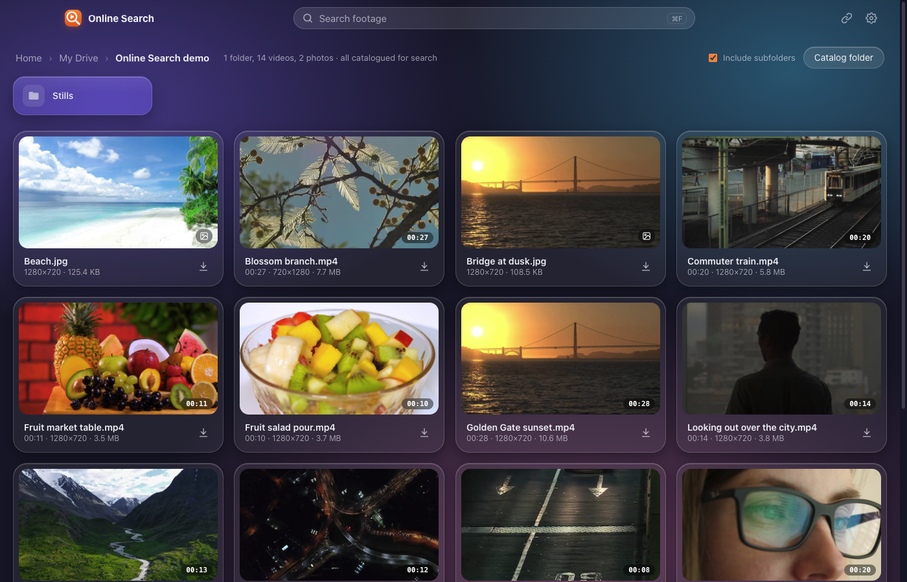
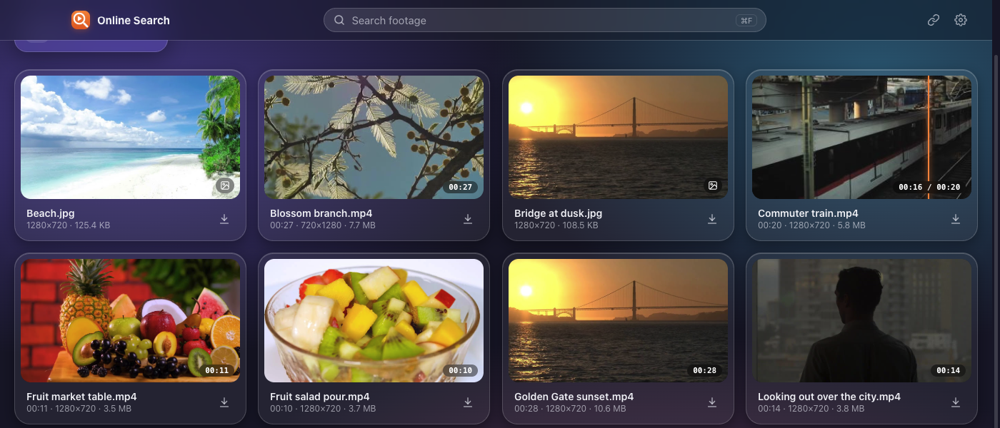
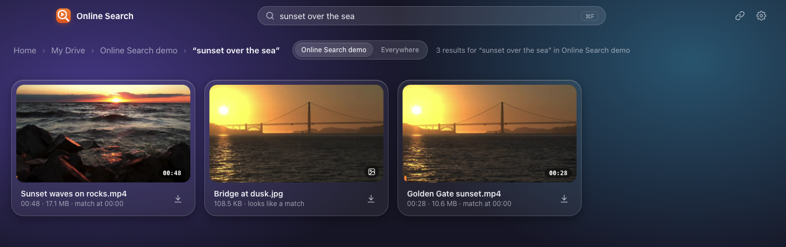
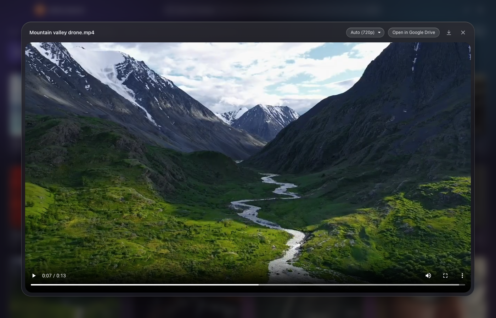
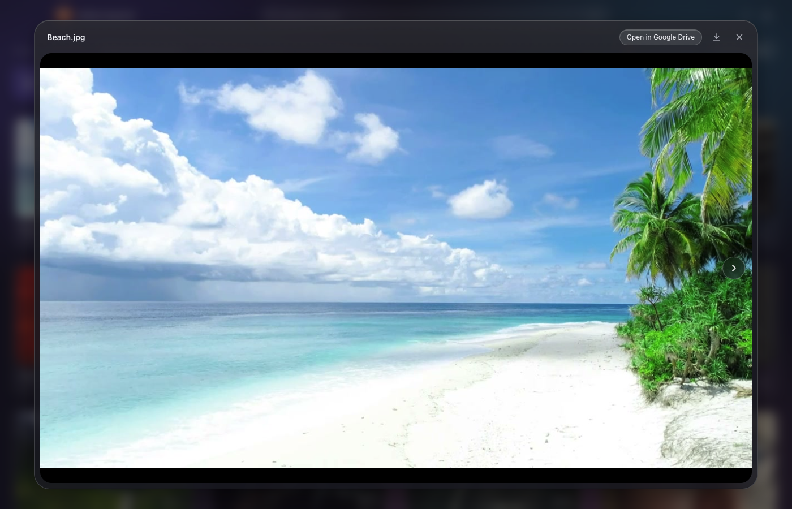

# Online Search

**Skim and search your Google Drive footage like a local library.** Online Search is a free, open-source Mac app for video teams and creators who keep camera footage and photos in Google Drive. Move the mouse across a clip to scrub through it, click to play from that moment, and search for what's *in* the shot ("sunset over the sea", "city at night") as you type.

[](LICENSE)
[](https://buymeacoffee.com/kenpercimoney)



By Percimoney Technologies. Everything runs on your Mac with your own Google account: footage stays in Drive, and nothing is sent anywhere else.

## 1. What it does

| | |
|---|---|
| **Hover scrub** | Move the mouse across any clip to scrub through it, with a playhead and timecode. Previews come from Drive's own 360p copy, so even 4K camera files scrub after a second or two. |
| **Search what's in the shot** | Type a description and matching clips appear, each marked at its best matching moment. An AI model ([MobileCLIP](https://github.com/apple/ml-mobileclip)) runs on your Mac; there's no API key or cloud service. File names are searched too, any part of the name. |
| **Fast playback** | Click a clip to play it from where you were hovering. It streams Drive's smaller copies (Auto, 1080p, 720p, 360p) like drive.google.com does, or the original file. |
| **Photos too** | Photos sit beside videos, open large, and step through with the arrow keys. RAW and HEIC work through Drive's previews. |
| **Shared catalogue** | Search catalogues live as small files in each Drive folder, so a whole team shares one catalogue and nobody catalogues the same clip twice. |
| **Downloads** | One click saves a clip straight to your Downloads folder, with progress. |
| **Your library, your drives** | My Drive, Shared with me, shared drives, recent files, or any Drive folder link. |
| **Calm design** | Frosted-glass panels over gradient backgrounds, with light and dark modes. |

## 2. Screenshots

**Hover to scrub.** The playhead and timecode follow the mouse.



**Search by what's in the shot.** Results show the matching moment.



**Play from where you hovered**, at a quality that suits the connection.



**Photos** open large, with the arrow keys stepping through the folder.



*Demo footage: free clips from [Mixkit](https://mixkit.co).*

## 3. Requirements

- A Mac with Apple Silicon (M1 or newer).
- [Node.js](https://nodejs.org) 20 or newer, to build the app.
- A Google account with footage in Drive.

## 4. Set up your own Google sign-in

The app talks to Google Drive with your own Google Cloud project, so you're in control of access and nobody else's limits apply. It's free and takes about ten minutes.

1. **Create a project.** Open the [Google Cloud console](https://console.cloud.google.com), create a project (any name, such as "Online Search") and select it.
2. **Turn on the Drive API.** Go to **APIs & Services → Library**, search for **Google Drive API** and click **Enable**.
3. **Set up the sign-in screen.** Go to **Google Auth Platform** and click **Get started**:
   - App name "Online Search", and your email address for support and developer contact.
   - Audience: **External** (or **Internal** if everyone is in your Google Workspace organisation, which skips the next step).
4. **Add test users.** Under **Audience → Test users**, add the Google account of everyone who will use the app (up to 100), including yourself. While the project is in testing, Google shows an "unverified app" screen at sign-in; click **Continue**.
5. **Allow Drive access.** Under **Data access → Add or remove scopes**, add:
   - `https://www.googleapis.com/auth/drive.readonly` (to browse and play footage)
   - `https://www.googleapis.com/auth/drive.file` (to save search catalogue files)
6. **Create the app's client.** Under **Clients → Create client**, choose **Desktop app**, name it and click **Create**. Keep the client ID and client secret it shows.
7. **Give them to the app.** In this project, copy the example settings and fill in the two values:

   ```bash
   cp desktop/config.example.json desktop/config.json
   ```

   ```json
   {
     "clientId": "1234-abcd.apps.googleusercontent.com",
     "clientSecret": "GOCSPX-…"
   }
   ```

   `desktop/config.json` is ignored by Git, so it never ends up in a commit. Google treats a desktop app's client secret as not confidential (the sign-in is protected with PKCE), but keep it to yourself anyway.

## 5. Run and build

Install the dependencies once:

```bash
npm install
```

Run the app straight from the code:

```bash
npm start
```

Or build a Mac app you can keep in Applications and share:

```bash
npm run dist
```

The installer appears in `dist/` as `Online Search-<version>-arm64.dmg`. It isn't signed with an Apple Developer certificate, so the first time it opens, macOS asks you to confirm in **System Settings → Privacy & Security → Open Anyway**. [desktop/INSTALL.md](desktop/INSTALL.md) is a step-by-step guide to send along with it.

## 6. Using it

1. Click **Sign in with Google** and allow access in your browser.
2. Open **My Drive**, a shared drive, or paste a Drive folder link with the link button.
3. Hover over clips to scrub; click to play.
4. To search a folder by what's in the shots, open it and click **Catalog folder** (tick **Include subfolders** for everything beneath it). A folder of a thousand clips is searchable in about two minutes; then type in the search box or press ⌘F.

## 7. Sharing it with a team

Build it once and send the installer to your team; each person signs in with their own Google account (add them as test users in step 4). If you'd like their copies to update themselves, [RELEASING.md](RELEASING.md) explains an optional setup: one command builds a new version and puts it in a private Drive folder, and everyone's app installs it on the next restart.

## 8. How it works

- **Hover previews** come from Drive's own 360p copy of each video. The app reads the copy's index, fetches the frames it needs in a few small requests, decodes them with WebCodecs, and keeps them on your Mac so folders scrub instantly next time.
- **Search** turns frames and your search text into embeddings with MobileCLIP S0, running in a background worker on the Mac's GPU. Each clip is stored as one compressed vector per distinct shot, about a kilobyte per clip, in a `.footage-scrub.idx` file in its Drive folder.
- **Playback** streams Drive's 360p to 1080p copies through a small local proxy in the app, or the original file through a service worker that prefetches the parts the player needs first.

[PRODUCT.md](PRODUCT.md) has the full design notes, measurements and roadmap.

## 9. Browser version (for development)

The same code runs in a browser:

```bash
python3 serve.py
```

Then open http://localhost:8765. It needs a **Web application** OAuth client (in step 6, choose Web application instead) with `http://localhost:8765` as an authorised JavaScript origin; paste its client ID into Settings. Browser sign-in lasts an hour and Drive's smaller copies aren't available, so previews and playback use the original files.

## 10. Limits

- Footage must be in a format the app can decode: H.264 and H.265 (MP4 or MOV) work; ProRes, DNxHD and most camera RAW video don't.
- Visual search matches what's visible in a shot, not what's said.
- Saving a catalogue in a folder needs edit access to that folder.
- Drive's smaller copies come from an undocumented Drive endpoint; if Google changes it, the app falls back to the original files.

## 11. Code map

| Path | Role |
|---|---|
| `web/index.html`, `web/styles.css` | Layout and the frosted-glass styling |
| `web/js/main.js` | Start-up and wiring |
| `web/js/auth.js` | Google sign-in (desktop or browser) |
| `web/js/drive.js` | Drive API: listings, folder paths, byte ranges |
| `web/js/views.js` | Screens, navigation, breadcrumbs, catalogue controls |
| `web/js/search.js` | Search as you type |
| `web/js/cards.js` | Clip and photo cards, hover scrub |
| `web/js/strips.js` | Hover filmstrips in memory, with a size budget |
| `web/js/filmstrip.js` | Reads MP4/MOV indexes and frames, decodes them with WebCodecs |
| `web/js/catalog.js` | The search catalogue: cataloguing, index files on Drive, scoring |
| `web/js/embed.js`, `web/catalog-worker.js` | MobileCLIP, run in a background worker |
| `web/js/player.js`, `web/sw.js`, `web/js/sw-client.js` | Video player and photo viewer; streaming through a service worker |
| `web/js/downloads.js` | Downloads (straight to Downloads in the Mac app) |
| `web/js/settings.js`, `web/js/theme.js` | Settings, backgrounds and glass strength |
| `web/js/idb.js` | Browser storage for saved previews and catalogue copies |
| `desktop/main.js`, `desktop/auth.js`, `desktop/preload.js` | Mac app shell, sign-in, downloads |
| `desktop/copies.js`, `web/js/copies.js` | Drive's smaller 360p/720p/1080p copies |
| `desktop/updates.js`, `web/js/updates.js`, `scripts/release.mjs` | Optional private updates (see RELEASING.md) |

## 12. Support the project

Online Search is free. If it saves you time, you can [buy me a coffee](https://buymeacoffee.com/kenpercimoney). Bug reports and pull requests are welcome too.

## 13. Licence

MIT. See [LICENSE](LICENSE).
